# Multilingual Speech Intelligence

An end-to-end AI system for **speech understanding, document-grounded question answering, and voice-based document interaction**.

The project combines speech foundation models, semantic retrieval, CrossEncoder reranking, and grounded language generation in an interactive Streamlit application.

## Features

- Speech transcription with **Whisper**
- Acoustic representation extraction with **WavLM**
- Transcript analysis with **Qwen2.5**
- Runtime PDF ingestion and text extraction
- Semantic retrieval with **Sentence Transformers**
- **CrossEncoder** reranking
- Relevance-based out-of-domain rejection
- Document-grounded question answering
- Voice-based PDF interaction
- Retrieval and reranking evaluation

---

## System Architecture

The application is organized into three workflows: speech analysis, document intelligence, and voice-based document QA.

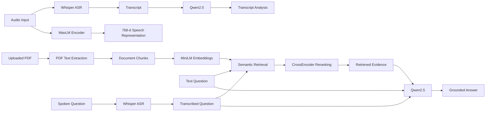

Whisper and WavLM are parallel speech components. The WavLM representation is not fused with the Whisper transcript or passed into the RAG pipeline.

---

## Speech Intelligence

The speech workflow processes an uploaded audio signal through two independent paths.

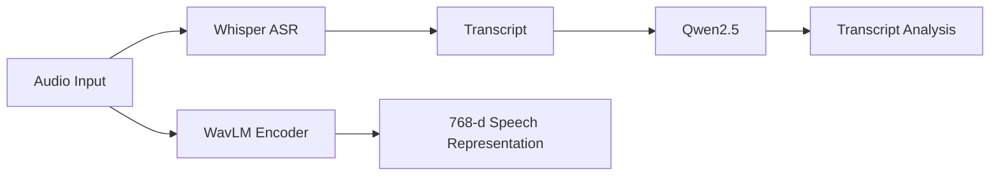

### Whisper

The project uses:

`openai/whisper-tiny`

Whisper performs automatic speech recognition:

`Audio → Speech Recognition → Transcript`

The resulting transcript is then available for language-level analysis.

### WavLM

The project uses:

`microsoft/wavlm-base-plus`

WavLM independently processes the same audio signal. Its hidden representations are mean-pooled into a **768-dimensional speech representation**.

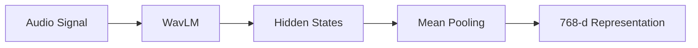

The WavLM vector is currently exposed as an acoustic representation. It is not passed to Qwen or used for document retrieval.

### Transcript Analysis

The Whisper transcript is analyzed using:

`Qwen/Qwen2.5-0.5B-Instruct`

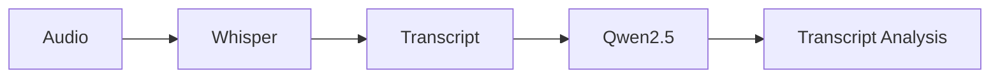

---

## Document Intelligence

The document workflow implements a two-stage retrieval architecture followed by grounded generation.

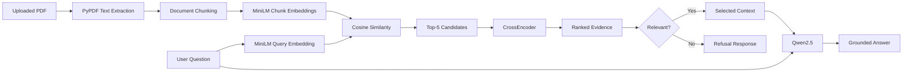

The language model receives selected document evidence rather than the complete PDF.

---

## PDF Processing

PDF text is extracted using `pypdf`.


The current implementation targets text-based PDFs. Scanned documents requiring OCR are outside the current pipeline.

### Chunking

Extracted text is divided into overlapping passages.

| Parameter | Value |
|---|---:|
| Chunk size | 500 characters |
| Overlap | 100 characters |

When possible, chunk boundaries are adjusted to finish at a sentence boundary.

The overlap helps preserve context between neighboring passages.

---

## Semantic Retrieval

The project uses:

`sentence-transformers/all-MiniLM-L6-v2`

for dense document retrieval.

Each document chunk is converted into a **384-dimensional embedding**.

The user question is encoded using the same model.

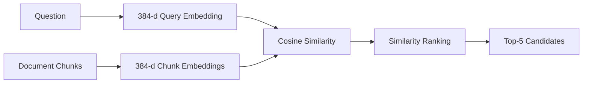

The first retrieval stage therefore performs:

`Question → Embedding → Cosine Similarity → Top-K`

The current implementation keeps embeddings in memory and does not require a persistent vector database.

---

## CrossEncoder Reranking

Dense retrieval efficiently identifies semantically related candidates, but the highest embedding similarity does not always correspond to the strongest evidence for a specific question.

A second retrieval stage therefore uses:

`cross-encoder/ms-marco-MiniLM-L-6-v2`

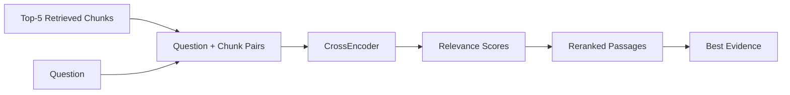

Unlike the bi-encoder retrieval stage, the CrossEncoder evaluates the question and candidate passage together.

This gives the project a two-stage retrieval architecture:

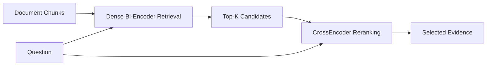

---

## Grounded Generation

The selected evidence is passed to:

`Qwen/Qwen2.5-0.5B-Instruct`

together with the user's question.

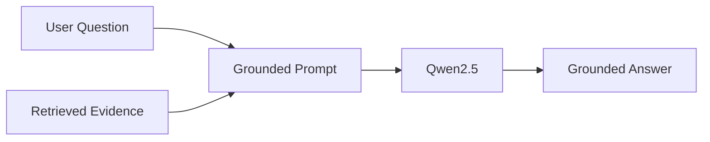

The generation prompt instructs Qwen to answer using only the supplied context.

If sufficient evidence is not available, the intended response is:

> I cannot answer this question based on the provided document.

---

## Relevance Filtering

Semantic search will always return a nearest result, even when the question is unrelated to the uploaded document.

A relevance check is therefore performed before grounded generation.

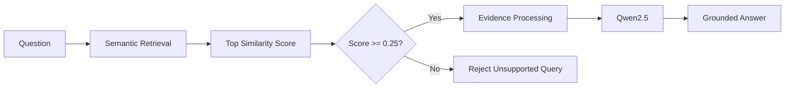

The current experimental relevance threshold is:

`0.25 cosine similarity`

Questions below the threshold are treated as insufficiently supported by the document.

This value is a project-level heuristic evaluated on the current benchmark. It should not be interpreted as a universally optimal RAG threshold.

---

## Voice Document QA

The third workflow connects speech recognition to the document retrieval pipeline.

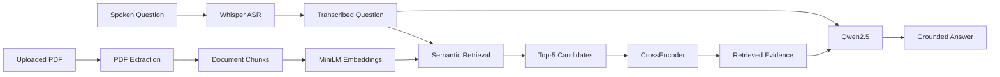

The workflow is:

`Speech → Transcription → Retrieval → Reranking → Evidence → Answer`

WavLM is intentionally not used in this workflow because document retrieval operates on the textual query produced by Whisper.

---

## Models

| Component | Model | Role |
|---|---|---|
| Speech Recognition | `openai/whisper-tiny` | Audio transcription |
| Speech Representation | `microsoft/wavlm-base-plus` | 768-d acoustic representation |
| Dense Retrieval | `sentence-transformers/all-MiniLM-L6-v2` | 384-d semantic embeddings |
| Reranking | `cross-encoder/ms-marco-MiniLM-L-6-v2` | Query-passage relevance scoring |
| Language Model | `Qwen/Qwen2.5-0.5B-Instruct` | Analysis and grounded generation |

### Model Responsibilities

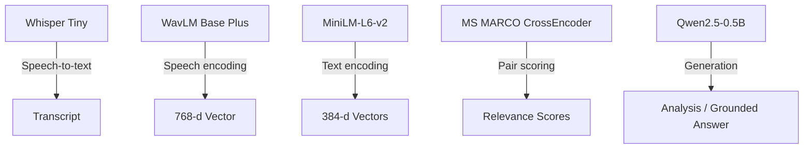

The 768-dimensional WavLM and 384-dimensional MiniLM representations belong to different processing paths and are not concatenated or fused.

---

## Evaluation

The retrieval pipeline includes a small evaluation suite covering:

- semantic retrieval
- CrossEncoder reranking
- in-domain retrieval
- out-of-domain rejection
- relevance-threshold behavior

### Benchmark

The current evaluation contains:

| Query Type | Count |
|---|---:|
| In-domain | 10 |
| Out-of-domain | 5 |
| **Total** | **15** |

The in-domain questions ask for information contained in the evaluation PDF.

The out-of-domain questions intentionally ask about unrelated topics.

### Results

| Metric | Result |
|---|---:|
| Recall@5 | **100%** |
| CrossEncoder Top-1 Accuracy | **100%** |
| Threshold Classification Accuracy | **100%** |
| Average relevant similarity | **0.6772** |
| Average irrelevant similarity | **0.1262** |
| Lowest relevant similarity | **0.4863** |
| Highest irrelevant similarity | **0.2138** |
| Experimental threshold | **0.25** |

### Similarity Separation

The benchmark produced a clear gap between the tested relevant and irrelevant questions.

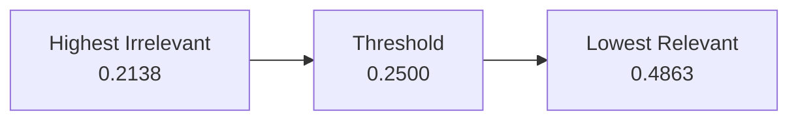

Average similarity:

| Query Group | Average Similarity |
|---|---:|
| Relevant | **0.6772** |
| Irrelevant | **0.1262** |

All 15 benchmark questions were classified correctly using the current threshold.

These results come from a **small, curated, single-document benchmark**. They should not be interpreted as 100% general RAG accuracy.

The benchmark is intended as a reproducible engineering sanity check for the retrieval architecture.

---

## Running the Evaluation

From the project root:

```bash
python evaluation/evaluate_rag.py
```

The evaluation reports:

```text
Questions evaluated: 15
Relevant questions: 10
Irrelevant questions: 5

Recall@5: 100.00%
Reranking Top-1 Accuracy: 100.00%
Threshold Classification Accuracy: 100.00%

Average relevant similarity: 0.6772
Average irrelevant similarity: 0.1262
Lowest relevant similarity: 0.4863
Highest irrelevant similarity: 0.2138
Current relevance threshold: 0.25
```

---

## Project Structure

```text
multilingual-speech-intelligence/
│
├── app.py
├── README.md
├── requirements.txt
├── .gitignore
│
├── data/
│   ├── paper.pdf
│   └── test_audio.mp3
│
├── src/
│   ├── transcribe.py
│   ├── audio_embeddings.py
│   ├── llm.py
│   └── rag.py
│
└── evaluation/
    └── evaluate_rag.py
```

### Module Responsibilities

| File | Responsibility |
|---|---|
| `app.py` | Streamlit interface and workflow orchestration |
| `src/transcribe.py` | Whisper speech recognition |
| `src/audio_embeddings.py` | WavLM representation extraction |
| `src/llm.py` | Qwen analysis and grounded generation |
| `src/rag.py` | PDF processing, retrieval, reranking and RAG |
| `evaluation/evaluate_rag.py` | Retrieval and relevance evaluation |

---

## Installation

### 1. Clone the Repository

```bash
git clone <YOUR-GITHUB-REPOSITORY-URL>
cd multilingual-speech-intelligence
```

### 2. Create a Virtual Environment

Windows:

```bash
python -m venv .venv
.venv\Scripts\activate
```

Linux/macOS:

```bash
python -m venv .venv
source .venv/bin/activate
```

### 3. Install Dependencies

```bash
pip install -r requirements.txt
```

Main dependencies include:

- `torch`
- `transformers`
- `sentence-transformers`
- `streamlit`
- `pypdf`
- `librosa`
- `soundfile`
- `numpy`

The required Hugging Face model weights are downloaded when the relevant components are loaded for the first time.

---

## Running the Application

Start the Streamlit application from the project root:

```bash
python -m streamlit run app.py --server.fileWatcherType none
```

The interface provides three workflows:

- **Speech Intelligence**
- **Document Intelligence**
- **Ask PDF with Voice**

The Streamlit file watcher is disabled to avoid conflicts between Streamlit module inspection and optional modules exposed by the Transformers ecosystem.

---

## Technology Stack

| Area | Technology |
|---|---|
| Language | Python |
| Deep Learning | PyTorch |
| Model Framework | Hugging Face Transformers |
| Speech Recognition | Whisper |
| Speech Representation | WavLM |
| Semantic Embeddings | Sentence Transformers |
| Retrieval | Cosine Similarity |
| Reranking | CrossEncoder |
| Language Model | Qwen2.5 |
| Document Processing | PyPDF |
| Audio Processing | Librosa |
| Interface | Streamlit |

---

## Design Decisions

### Separate Whisper and WavLM Paths

Whisper and WavLM solve different speech-processing tasks.

**Whisper**

`Speech → Linguistic Content`

**WavLM**

`Speech → Acoustic Representation`

The project intentionally keeps these components separate rather than presenting them as a fused multimodal architecture.

### Two-Stage Retrieval

The retrieval architecture combines a bi-encoder and a CrossEncoder.

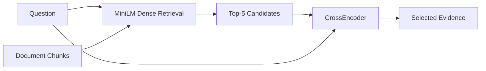

MiniLM provides efficient candidate retrieval, while the CrossEncoder performs a more precise comparison over the smaller candidate set.

### Grounded Generation

The language model is placed after retrieval rather than answering document questions directly.


This architecture helps constrain document QA to retrieved evidence.

### Out-of-Domain Handling

Nearest-neighbor retrieval always returns something.

The relevance threshold provides an additional gate before generation so clearly unrelated questions can be rejected rather than passed directly to the LLM.

---

## Current Limitations

- The evaluation benchmark contains only 15 queries and one document.
- The `0.25` relevance threshold is experimentally selected rather than universally calibrated.
- Embeddings are stored in memory rather than in a persistent vector database.
- PDF processing currently targets machine-readable text.
- Scanned PDFs requiring OCR are not supported.
- WavLM embeddings are extracted but are not yet consumed by a downstream classifier or retrieval component.
- Running several Transformer models locally can be computationally expensive on CPU-only environments.
- Multilingual and code-switched speech performance still requires systematic benchmarking.
- The current system is an AI engineering prototype rather than a production-scale retrieval service.

---

## Future Work

Planned extensions focus primarily on evaluation, scalability, and deployment:

- multilingual speech evaluation
- Darija, French, and English code-switching tests
- Word Error Rate evaluation for ASR
- larger document QA benchmarks
- multi-document retrieval
- relevance-threshold calibration
- persistent vector indexing for larger corpora
- model caching and inference optimization
- retrieved-evidence visualization
- production API separation
- deployment optimization

---

## What This Project Demonstrates

The repository covers several parts of an applied AI stack:

| Area | Implemented Concepts |
|---|---|
| Speech AI | ASR, learned speech representations |
| NLP | semantic embeddings, language models |
| Information Retrieval | dense retrieval, cosine similarity, reranking |
| RAG | ingestion, chunking, retrieval, grounding, generation |
| Evaluation | Recall@K, reranking accuracy, relevance rejection |
| Application Engineering | interactive Streamlit interface |

---

## Author

**Oumaima Ouayres**

Data Science & AI  
Machine Learning · NLP · Speech AI · Retrieval-Augmented Generation
